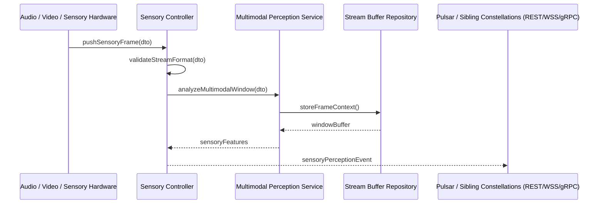

<p align="center"></p>

<h1 align="center">Lyra</h1>
<p align="center"><strong>Sovereign pure-Rust multimodal sensory perception engine for audio, music, video, and sensory streams</strong></p>

<p align="center">
  
  
  
  
  <a href="LICENSE"></a>
  <a href="https://natuleadan.com"></a>
</p>

## 1. What is Lyra?

Lyra is a sovereign, pure-Rust **multimodal sensory perception engine** enabling autonomous agents to ingest audio, music, video, and continuous sensory streams modeled after human perception. Engineered with deterministic media and signal pipelines, zero Node.js or Python wrapper dependencies, and decoupled wire-protocol interfaces (REST, WebSocket/WSS, gRPC) with zero direct Cargo coupling to sibling constellations, Lyra transforms raw acoustic and visual inputs into structured agent events across diverse devices.

### What is inside

Lyra implements a layered six-file modular domain layout (`entity`, `dto`, `repository`, `service`, `controller`, `mod`) atop a pure-Cargo workspace (`crates/core` and `crates/xtask`), governed by eight native validation gates and a 3-day dependency cooldown.

> **Current scope:** This release ships the native validation harness, the six-file modular reference domain (`modules/math`), and the crate contracts. Transports, sandboxes, domain engines and protocol integrations described throughout this document are planned milestones, not shipped capabilities.

## 2. Why Lyra?

Multimodal sensory perception for AI agents typically relies on fragile Python bindings and heavy native C++ media wrappers that break across platforms and lack strict boundary verification.

- **Human-like multimodal sensory perception**: Enables agents to ingest audio, music, video, and continuous sensory streams natively in pure Rust.
- **100% Pure native Rust**: Zero Node.js, zero Python, and zero unverified package ecosystems.
- **Strict layer isolation**: Media transport controllers, planned multimodal DSP services, and stream buffer repositories are decoupled by automated boundary tests.
- **Zero formatter drift**: Formatters are excluded from hooks and CI so diffs remain focused on signal and media pipelines.

## 3. Highlights

- **Deterministic multimodal media contracts**: Typed audio frames, video/image frames, spectral descriptors, and structured sensory events.
- **Pure Cargo automation via `xtask`**: Native `cargo xtask validate`, `notices`, and `release` subcommands.
- **Eight standardized validation gates**: Full verification across lint, typecheck, unit tests, architecture tripwires, cooldown, hygiene, notices, and SemVer checks.
- **Supply-chain hardening**: Enforced 3-day dependency publish cooldown (`resolver.min-publish-age="3 days"`), CodeQL, and SBOM artifacts.
- **Apache-2.0 licensed**: Clear commercial terms with automated `ThirdPartyNotices.txt` verification.

## 4. Quick Start

Ensure Rust `1.85+` (Rust 2024 edition / stable, matching `rust-version = "1.85"`) is installed:

```bash
# Clone the repository
git clone https://github.com/natuleadan/lyra.git
cd lyra

# Activate local hooks
git config core.hooksPath .githooks

# Run the complete 8-gate native validation suite
cargo xtask validate
```

Other native `xtask` operations:

```bash
cargo xtask notices          # Regenerate ThirdPartyNotices.txt from cargo metadata
cargo xtask release --check  # Verify Cargo.toml version and CHANGELOG parity
cargo test --workspace       # Execute unit, integration, and architecture tests
```

## 5. Use Cases

- **Agent multimodal perception**: Allow Pulsar agents to ingest live audio, music, video, and sensory streams deterministically.
- **Acoustic, musical & visual analysis**: Extract tempo, pitch contours, spectral signatures, and frame-level visual cues natively in Rust.
- **Cross-device sensory pipelines**: Run consistent multimodal stream processing across desktop workstations, Linux servers, and diverse edge hardware.

## 6. How It Works



Incoming audio, music, video, and sensory frames enter through the `controller`, validate stream formats via `dto`, extract acoustic and visual features inside `service`, and emit structured perception events over decoupled wire protocols (REST, WSS, gRPC).

## 7. Status and Roadmap

- **Status**: Initial foundation — validation harness and modular reference skeleton in place; domain implementation in progress.
- **Milestone 1**: Core multimodal frame entities (PCM audio, video frames), format DTOs, and deterministic windowing traits.
- **Milestone 2**: Spectral, pitch, rhythm, and visual stream feature extractors in pure Rust.
- **Milestone 3**: Decoupled wire-protocol (REST, WSS, gRPC) sensory integration with Pulsar and sibling constellations.

## 8. Repository Layout & Validation Gates

```text
.
├── .cargo/                  # Cargo configuration and 3-day cooldown resolver
├── .githooks/               # Versioned commit-msg, pre-commit, and pre-push hooks
├── .github/                 # Issue templates, dependabot config, and CI workflows
├── crates/
│   ├── core/                # Core multimodal sensory library (modules/math reference domain, lib.rs)
│   │   └── tests/           # integration.rs and immutable architecture.rs tripwires
│   └── xtask/               # Pure-Rust automation CLI (cargo xtask <cmd>)
├── .env.example             # Environment contract template (copy to git-ignored .env)
├── Cargo.toml               # Workspace manifest (rust-version = "1.85", [workspace.lints])
├── clippy.toml              # Strict Clippy policy (max-fn-params-bools = 0)
├── ARCHITECTURE.md          # Modular domain architecture specifications
├── AGENTS.md                # Autonomous AI agent operating guidelines
├── CONTRIBUTING.md          # Contribution workflow and commit grammar
├── SECURITY.md              # Supply-chain policies and vulnerability reporting
├── LICENSE                  # Apache-2.0 License
├── NOTICE                   # Copyright (c) 2026 Natuleadan.
└── ThirdPartyNotices.txt    # Automated third-party license inventory
```

| Gate | Command | Purpose |
| :--- | :--- | :--- |
| `lint` | `cargo clippy --workspace --all-targets --all-features -- -D warnings` + `cargo doc -D warnings` | Strict zero-warning static analysis and rustdoc checks |
| `typecheck` | `cargo check --workspace --all-targets` | Workspace type verification |
| `unit tests` | `cargo test --workspace --lib` + `--doc` | Library unit tests and runnable doc examples |
| `integration and architecture tests` | `cargo test --workspace --test '*'` | Integration flows and layer tripwires |
| `cooldown` | `cargo --config 'resolver.min-publish-age="3 days"'` | 3-day package release cooldown |
| `hygiene` | `crates/xtask/src/hygiene.rs` | 500-line limit, anti-leak, and syntax checks |
| `notices` | `crates/xtask/src/notices.rs` | License inventory parity check |
| `release` | `crates/xtask/src/release.rs` | SemVer and CHANGELOG consistency |

## 9. Documentation

- [ARCHITECTURE.md](ARCHITECTURE.md): Modular architecture, layer boundaries, and design invariants.
- [CONTRIBUTING.md](CONTRIBUTING.md): Issue-first contribution policy, PR workflow, and commit grammar.
- [SECURITY.md](SECURITY.md): Vulnerability disclosure procedures and supply-chain controls.
- [AGENTS.md](AGENTS.md): Machine-facing instructions for autonomous engineering.

## 10. Ecosystem & Community

Lyra is the multimodal sensory perception constellation of Natuleadan, communicating strictly over decoupled wire protocols (REST, WSS, gRPC) with Orion, Andromeda, Aurora, Pleaides, Pulsar, Caelum, and Skills.

<p align="left">
  <a href="https://github.com/natuleadan"></a>
  <a href="https://github.com/leojara95"></a>
</p>

Bug reports and feature proposals are tracked via structured GitHub Issues.

## 11. Contributing

External pull requests are restricted to maintainers (`collaborators_only`). Please open an issue describing your bug or proposal. See [CONTRIBUTING.md](CONTRIBUTING.md) for details.

## 12. License & Star History

This project is licensed under the Apache License 2.0. Copyright (c) 2026 Natuleadan.

Terms are in [LICENSE](LICENSE), attribution in [NOTICE](NOTICE), and third-party dependency notices in [ThirdPartyNotices.txt](ThirdPartyNotices.txt).

<a href="https://www.star-history.com/#natuleadan/lyra&Date">
  <picture>
    <source media="(prefers-color-scheme: dark)" srcset="https://api.star-history.com/image?repos=natuleadan/lyra&type=date&theme=dark" />
    <source media="(prefers-color-scheme: light)" srcset="https://api.star-history.com/image?repos=natuleadan/lyra&type=date&theme=light" />
    
  </picture>
</a>
